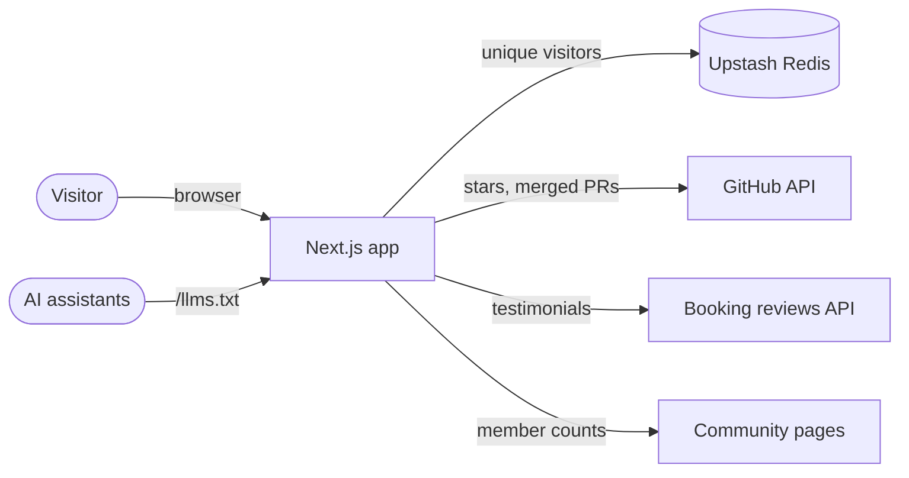

# Mini Anon Portfolio: High-Level Design

My main portfolio at [minianon.in](https://minianon.in): profile, experience, projects, blogs, open-source contributions, community stats, testimonials, sponsors and a live visitor counter. For code-level detail see the [Low-Level Design](lld.md).

## 1. System context

Content lives in typed files under `src/data`; live numbers come from route handlers that cache upstream calls.

## 2. Pages

| Route | Content |
|---|---|
| `/` | Hero / profile, stats strip, experience, highlights, projects (masonry), contributions, community, testimonials, philosophy, free resources, sponsors, reach-out |
| `/projects`, `/projects/[id]` | Project list and project detail |
| `/blogs`, `/blogs/[id]` | Blog list and posts (Markdown) |
| `/sponsors` | Sponsor showcase and empty slots |
| `/llms.txt` | Plain-text site summary for AI agents |

## 3. API routes

| Route | Source | Cache |
|---|---|---|
| `/api/visitors` (GET, POST) | Upstash Redis set of browser fingerprints | none |
| `/api/repo-stars` | GitHub REST: all owned repos, summed stars | 1 h |
| `/api/github-stars` | Stars for one repo | per request |
| `/api/github-contributions` | Merged pull requests by the author (Octokit search) | per request |
| `/api/testimonials` | Booking-platform reviews | 6 h |
| `/api/community-stats` | Member counts scraped from public community pages | 1 h |

## 4. Tech

| Layer | Choice |
|---|---|
| Framework | Next.js (App Router), React, TypeScript |
| UI | Tailwind CSS, Radix primitives, Magic UI, Framer Motion / Motion, Tabler and Lucide icons |
| Data | `@upstash/redis`, `@octokit/rest`, `react-github-calendar`, `react-markdown` |
| Theme | `next-themes` light / dark |
