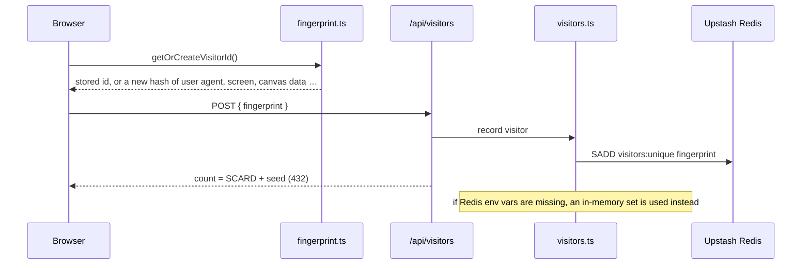

# Mini Anon Portfolio: Low-Level Design

For the big picture see the [High-Level Design](hld.md).

## 1. Source layout (`src/`)

| Path | Role |
|---|---|
| `app/page.tsx` | Renders `HomeContent` (exported as `NewHeroSection`) and the `OnekoCat` cursor pet |
| `app/projects`, `app/blogs`, `app/sponsors` | List and detail pages |
| `app/api/*/route.ts` | Live data endpoints |
| `app/llms.txt/route.ts` | `text/plain` summary for AI assistants |
| `components/` | Sections and cards (`ProfileHeader`, `ExperienceContent`, `MasonryProjectCard`, `ContributionsDisplay`, `SponsorShowcase`, `VisitorCount`, `TechStackMarquee`, …) |
| `data/` | `projects.ts`, `blogs.ts`, `experience.ts`, `highlights.ts`, `sponsors.ts`, `shortLinks.ts` |
| `lib/` | `github.ts`, `visitors.ts`, `fingerprint.ts`, `animations.ts`, `utils.ts` |
| `types/` | `project`, `blog`, `sponsor` types |

## 2. Visitor counter

## 3. GitHub data (`lib/github.ts`)

| Function | Call |
|---|---|
| `fetchUserPullRequests(username, limit)` | `GET /search/issues` with `is:pr author:<user> is:merged` |
| `fetchRepositoryStars(owner, repo)` | Repository stargazer count |
| `/api/repo-stars` | Pages through `/users/minianon/repos?type=owner`, sums stars, revalidates hourly |

## 4. Content model

Projects, blogs, experience, highlights and sponsors are typed arrays in `src/data`. Adding a project or post means adding one object; list and detail pages read them by `id`.

## 5. Configuration

| Variable | Purpose |
|---|---|
| `UPSTASH_REDIS_REST_URL`, `UPSTASH_REDIS_REST_TOKEN` | Visitor counter (optional; falls back to memory) |
| `GITHUB_TOKEN` | Higher GitHub API rate limits (server-side only) |
